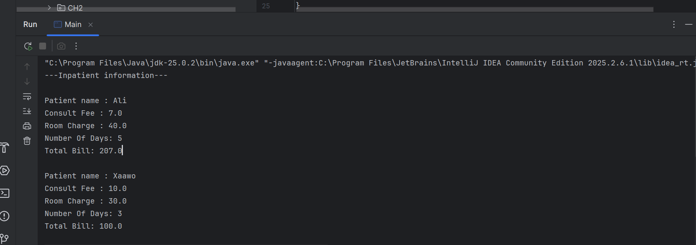

# Hospital Management System

## Assignment Overview

The Hospital Management System is a Java programming assignment developed for the Data Structure Using Java course. The program calculates hospital bills for inpatients and outpatients using Object-Oriented Programming (OOP) concepts.

## Classes

### 1. Patient
The abstract parent class that stores the patient's name and consultation fee. It also provides a method to display basic patient information and declares the abstract `CalculateBill()` method.

### 2. InPatient

A subclass of `Patient` that stores the room charge and number of days the patient stays in the hospital.

**Billing formula:**

Total Bill = Consultation Fee + (Room Charge × Number of Days)

### 3. OutPatient

A subclass of `Patient` that stores the laboratory charge.

**Billing formula:**

Total Bill = Consultation Fee + Lab Charge

### 4. Main

The main class that creates inpatient and outpatient objects and displays their information and calculated bills.

## OOP Concepts Applied

- **Abstraction:** The `Patient` class is an abstract class and declares an abstract billing method.
- **Inheritance:** `InPatient` and `OutPatient` inherit from `Patient`.
- **Polymorphism:** Both subclasses provide their own implementation of `CalculateBill()`.
- **Constructors:** Initialize patient details and billing information.
- **Method Overriding:** Each subclass implements the billing method according to its billing rules.

## Output Screenshots

### 1. Inpatient Output

This screenshot shows the inpatient information, consultation fee, room charge, number of days, and total bill.

2. Outpatient Output

This screenshot shows the outpatient information, consultation fee, laboratory charge, and total bill.

## Tools Used

- Java
- IntelliJ IDEA
- Git and GitHub

## Conclusion

This assignment demonstrates how Java OOP concepts can be used to organize patient information and calculate different types of hospital bills through inheritance, abstraction, and method overriding.